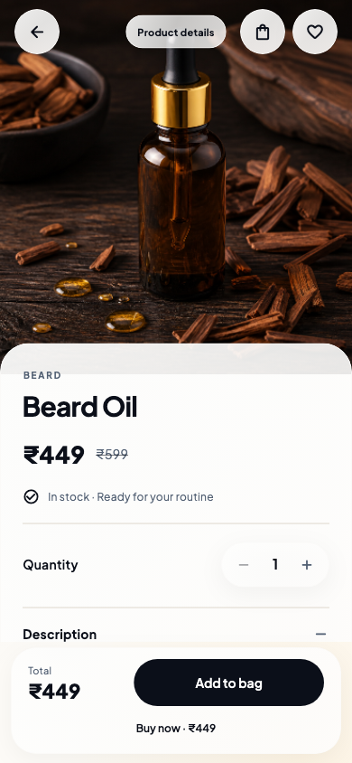

# Editorial redesign · 1.5.0 (8)

The supplied mobile reference informed the white and stone palette, charcoal actions, image-first catalog, restrained card corners and translucent floating navigation. The existing Urban Blade service and commerce flows remain connected.

## Changes

- Home: editorial studio photography, oversized serif headline, category wordmarks, booking and shopping actions, essentials grid.
- Catalog: taller photography, compact product information, save controls, pricing and add-to-bag actions.
- Details: larger portrait image, serif product title, availability, quantity and checkout controls.
- Shared theme: neutral surfaces and borders, low-elevation cards, charcoal buttons, updated headings across booking, account, cart and checkout.
- Motion: sliding dock selection, press feedback, shared-image transitions and reduced-motion support. Image decode sizing, retained tabs and repaint boundaries are preserved.
- Uses existing bundled photography and fonts; no additional image downloads or runtime dependencies.

## Validation

Flutter analysis: no issues. All 26 Flutter tests pass, including commerce behavior, booking, saved products, responsive layouts and reviewed screen baselines. Updated baselines live in `test/goldens/`.

The existing Android display-mode request supports up to 120 Hz. Actual 120 FPS has not been measured on a physical device. Follow `PERFORMANCE.md` for profiling. Release packaging retains the existing signing configuration.

## Preview

