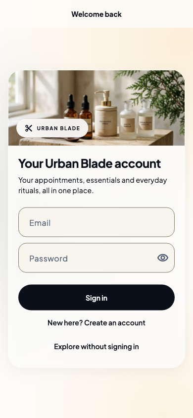
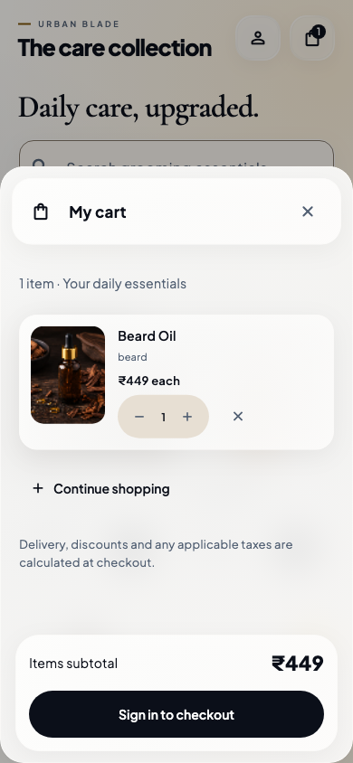

# Urban Blade premium mobile redesign — 2.5.0 (20)

An original Urban Blade design inspired by the supplied mobile commerce references: generous photography, editorial hierarchy, rounded overlapping surfaces and a floating navigation dock. Warm ivory, obsidian, amber and slate retain the brand identity. The photographs and products belong to the existing app; the references guide composition rather than introducing pharmacy content, invented offers or unsupported product options.

## Visual changes

- A floating frosted navigation capsule with an active icon-and-label pill, accessible destination semantics, cart badges and space reserved above the dock. Compact widths retain five full-size targets and collapse the active label when necessary.
- A translucent header with generous circular touch targets and a short theme-icon transition.
- Larger home photographs with bottom glass captions, editorial serif feature titles and a simplified discovery hierarchy. Product cards pair uninterrupted imagery with a readable name/price caption.
- Glass service and shop controls, animated service selection and readable sorting labels. Product detail combines an immersive photo, floating controls, an overlapping detail surface and a clear purchase dock.
- Frosted action areas and sheet headers in booking, checkout, cart and editors; glass profile appearance choices and appointment cards.
- Static amber/slate background washes show through translucent surfaces in both light and dark modes. Sign-in and registration use a compact photographic header, generous form spacing and improved autofill/password controls.

The central GlassPanel defines reflection, tint, borders, radius and depth. Captions use the actual shared border inset when measuring text, preventing long labels from overflowing at accessibility sizes.

## Motion and rendering

- Navigation selection uses a short animation; booking/UPI content transitions combine a small slide with a fade. iOS route swipe behavior remains native. Android route transitions use translation rather than opacity over the entire image-heavy page.
- Reduced-motion settings bypass animated transitions and icon motion. High-contrast and accessible-navigation settings replace frosted surfaces with an opaque, blur-free material.
- Backdrop blur is clipped to photo captions and bounded chrome/action areas. Scrolling product/service cards use reflective materials without per-row backdrop filters. Whole-page cart and order/receipt sheet backdrop filters have been removed. A stronger photo-caption tint retains contrast without adding a filter to each product card.
- Ambient backgrounds have no recurring animation. Existing image decoding limits, retained tab drafts and disabled inactive tickers remain in place.
- Booking service menus now use lazy slivers. A 100-service regression verifies that only nearby rows mount, while selecting a distant service and moving to schedule/review still works.

Text contrast over white and black backdrops is tested. Initial frosted captions fell below the normal-text threshold over a dark image; stronger caption frost corrected that defect while retaining the translucent effect. There is no measured device FPS claim.

## Verification and release

Final analyzer/test/build results are recorded in [the glass verification log](../../docs/test-results/mobile-glass-verification-2026-10-14.txt). The tests cover glass contrast/tap targets, small phones, landscape, large text, keyboards, reduced motion, reversible booking transitions, cart interaction and the existing account/payment/API regressions. Visual baselines are inspected before their final comparison run.

Android keeps the existing debug release-signing configuration for local installation. Store distribution needs production signing. Native iOS interaction and real payment/UPI behavior require device checks; no purchase or production deployment is performed by the automated verification.

## Previews

