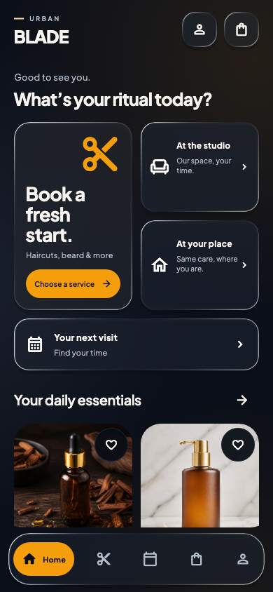

# Mobile repairs and polish — 2.4.0 (19)

Date: 14 October 2026.

## Design direction

The user authorized changes to the overall layout and requested Pinterest/Dribbble inspiration. The reviewed salon references use image-led offerings, clear service/date/time sections, readable pricing and prominent booking actions. Urban Blade adapts these patterns using its own obsidian, champagne amber and slate identity, bundled photography and Plus Jakarta Sans typography.

- [Dribbble: Salon Mobile App](https://dribbble.com/shots/21821018-Salon-Mobile-App)
- [Pinterest: Beauty Salon App Design](https://www.pinterest.com/pin/60587557482441473/)

The updated theme uses warm, quieter input and card surfaces, clear control contrast, subtle header/navigation dividers and an editorial home introduction. Dark mode uses obsidian surfaces and amber selections. Supported Android wallpaper palettes continue to work without replacing navigation state.

## Repaired defects

- The server no longer publishes its staff directory and rejects customer staff assignments. Mobile booking now works with an empty stylist list, sends one service plus salon/home visit details and displays the server-confirmed price. Removed the unsupported home surcharge and outdated stylist-selection requirement.
- The service request used the wrong category parameter, allowing retail products into the service menu. Requests now use the current filter; unavailable services are omitted. Catalog numeric fields, snake_case payloads, page-limit caching and overlapping refreshes are handled consistently.
- Appointment identifiers/statuses and date/time rows overflowed on narrow phones with large text. Flexible sections and wrapping keep them readable. Empty appointment states can scroll in short landscape viewports.
- Booking date cards grow with the actual text scale. Pricing and final actions adapt to constrained widths in booking, checkout and order details.
- Delivery/profile sheets keep Save above gesture areas and allow scrolling with landscape keyboards. Delivery saves block repeated taps and expose retryable errors.
- A cart sheet subtracted the keyboard from a fixed fraction of the viewport, leaving insufficient content height. It now uses the actual available height.
- Offstage tab fields retained keyboard focus. Hidden tabs now relinquish focus while preserving their text and scroll drafts.
- Multiple network status banners crowded out the landscape page. Messages now scroll within a bounded region.
- Booking failure recovery could update a disposed screen; checkout could open a disposed payment gateway. Mounted guards prevent both while keeping interrupted payment drafts resumable.
- Logout/session expiry could leave private drafts visible or allow delayed profile/auth responses to restore an old account. Account generations and serialized session persistence protect account transitions.
- PDF export was implemented only on Android. iOS now validates PDF payloads, opens the system export picker, handles cancellation and removes temporary documents. The implementation uses [Apple's document export API](https://developer.apple.com/documentation/uikit/uidocumentpickerviewcontroller/init%28forexporting%3Aascopy%3A%29).
- Mobile source was excluded wholesale from Git. The ignore rules now permit source, tests and assets while excluding generated files and signing material.

## Verification

- Flutter analyzer: no issues.
- Complete Flutter suite: **120 tests passed**, including all refreshed visual baselines.
- Dedicated regressions exercise portrait and landscape layouts, 320-pixel-wide phones, 200% text, device gesture padding and open keyboards. Header controls are also checked at 300% text.
- API and session regressions cover no-stylist booking, structured home visits, server prices, catalog filtering/cache invalidation and late responses during account changes. Read-only deployed API checks also returned HTTP 200 for the service filter, empty public staff directory and date-only availability.
- Required repository checks: **15 guideline checks passed; 49 admin operations passed**. Both use disposable test databases.
- Website production build passed with two build workers after the initial build tool process crashed.
- Android APK **2.4.0 (19)** built and its v2 signature verified. Final iOS simulator app **2.4.0 (19)** built successfully. A generated framework signing error cleared after rebuilding the framework.
- An interactive iOS launch check could not finish because the simulator installation service was unresponsive; the test simulator was shut down. Native Files picker interaction and payment handoff still need interactive device checks.

Android/iOS build results and artifacts are recorded in the repository's [verification log directory](../../docs/test-results/). No production deployment or live payment was performed. Store signing and payment-provider behavior on physical devices remain release checks.

## Reviewed previews

