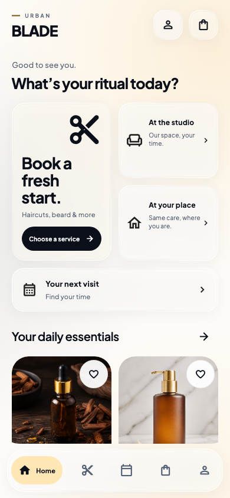
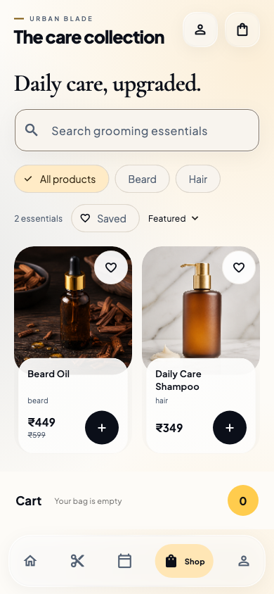
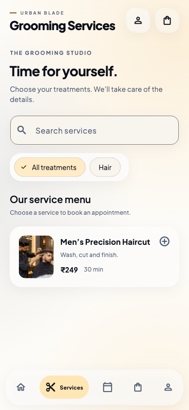
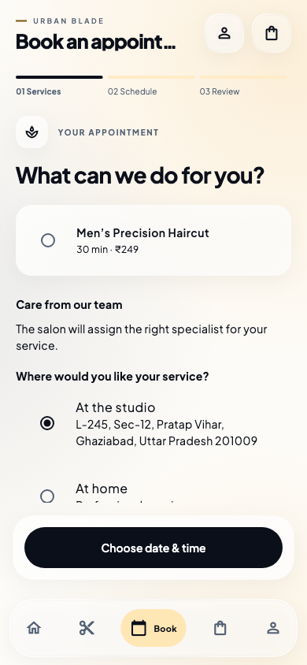

# UI polish and rendering audit · 1.7.0 (10)

## Reproduced defects

Before the fix, the shell body extended to y=720 on a 320×720 viewport while navigation began at y=628. Sticky service/cart actions occupied the same region as the dock. The regression also reproduced a 13 px vertical overflow in navigation at 200% text size.

## Fixes

- Reserve the full dock height using scaffold layout rather than hand-added overlap padding. Remove obsolete 112 px scroll padding. Keep the navigation rail visually separated from the content.
- Hide navigation while the keyboard is open; preserve the search query. At large text sizes use icon-only navigation with full semantic labels and tooltips.
- Replace live backdrop blur and layered card shadows with pre-tinted materials. Remove image-heavy tab opacity/translation transitions; keep the small navigation indicator animation and route slide.
- Switch booking steps without the old and new page overlapping in a crossfade.
- Decode images to their actual bounded card width. At DPR 3 a 168 px card now requests roughly 504 px, rather than a 390 px phone's 1170 px; decode allocation scales with image area. This is a code-path comparison, not a measured FPS claim.
- Build home product rows and service cards lazily. Preserve inactive tab drafts, scroll positions, and disabled tickers.
- Defer press animation until a deliberate hold and cancel on scroll, avoiding two scale updates for every drag.
- Refine the visual hierarchy with bold sans-serif headings, neutral grey/white materials, consistent rounded cards, larger readable labels and clear booking actions.

## Verification

Final verification: Flutter analyzer clean; all 37 tests pass, including visual baselines.

The new tests cover 320×720, 412×915 and 800×400 viewports at 100% and 200% text sizes, every tab's bounds, sticky booking/bag actions, keyboard search retention, card image decode size, scroll gesture feedback, and a 100-service catalog. Existing behavior checks cover booking, commerce, saved items, authentication, payment recovery and retained tabs. Updated visual baselines are in `test/goldens/`.

The Nothing Phone 3a was not connected: ADB returned no devices. No physical-device frame timing has been measured. Use the profile instructions in `PERFORMANCE.md` before claiming 120 FPS or a specific improvement. The release retains existing signing configuration.

## Research and interpretation

The direction uses Apple TV's prominent content imagery, distinct content sections and clear navigation as inspiration, adapted to grooming and booking. It does not copy media assets or claim to implement Apple's native Liquid Glass.

- [Apple TV on iPhone](https://support.apple.com/en-sg/guide/iphone/iph1120cb3aa/ios)
- [Dribbble: video-streaming mobile UI concept](https://dribbble.com/shots/26504226-Video-Streaming-Mobile-App-UI-Concept)
- [Pinterest: movie-streaming mobile UI](https://in.pinterest.com/pin/34691859627526248/)
- [Figma: mobile UI kit and component approach](https://www.figma.com/templates/mobile-ui-kit/)
- [Apple: layout guidelines](https://developer.apple.com/design/human-interface-guidelines/layout)
- [Flutter: performance best practices](https://docs.flutter.dev/perf/best-practices)

No Figma files were modified. Existing generated photography remains bundled locally.

## Preview

